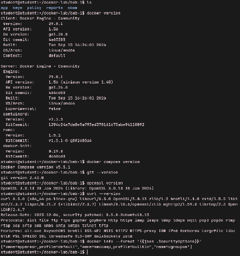

> **Lampiran Dokumen PDF:** [LAPORAN DevSecOps BAB-1.pdf](./docker-lab/bab-1/LAPORAN%20DevSecOps%20BAB-1.pdf)

<object data="./docker-lab/bab-1/LAPORAN%20DevSecOps%20BAB-1.pdf" type="application/pdf" width="100%" height="600px">
  
Pratinjau PDF tidak didukung oleh viewer. Buka tautan file: <a href="./docker-lab/bab-1/LAPORAN%20DevSecOps%20BAB-1.pdf">LAPORAN DevSecOps BAB-1.pdf</a>.

</object>

# **Praktikum 1 \- Menetapkan Baseline Laboratorium**

Praktikum ini membuat direktori kerja tunggal dan merekam versi komponen. Rekaman versi diperlukan karena hasil scan dan perilaku tool dapat berubah. Jalankan pada host Linux/VM yang memang disiapkan untuk laboratorium.

mkdir \-p \~/devsecops-lab/bab-1/{app,policy,reports,sbom,keys}  
cd \~/devsecops-lab  
docker version  
docker compose version  
git \--version  
openssl version  
curl \--version  
docker info \--format '{{json .SecurityOptions}}'

# **Verifikasi**

* Docker daemon dapat diakses oleh akun praktikum dan docker compose menggunakan plugin v2.  
* Direktori reports, sbom, dan keys tidak dipublikasikan sebagai web root.  
* SecurityOptions menampilkan mekanisme host yang tersedia; hasil berbeda antardistribusi harus dicatat.  
* Pembaca menulis satu paragraf threat statement: aset, aktor ancaman, jalur serangan, dan dampak.

# **Evaluasi dan Latihan Mandiri**

1. Mengapa DevSecOps tidak dapat direduksi menjadi penambahan scanner pada pipeline?

   * Karena DevSecOps adalah perubahan budaya, proses, dan pola pikir, bukan hanya sekedar alat untuk diimplementasikan.  
2. Evidence apa yang membedakan klaim kontrol dari kontrol yang benar-benar terverifikasi?

   * Bukti konkrit dan objektif menjadi perbedaan. Klaim kontrol seringkali berasal dari asumsi, bias kognitif atau kebetulan. Sedangkan kontrol terverifikasi didukung oleh bukti eksperimental di mana variabel yang dimanipulasi secara langsung menyebabkan perubahan pada hasil.

3. Bagaimana shared responsibility mempengaruhi ownership risiko dan tindak lanjut temuan?

   * Keamanan tidak lagi menjadi beban tim security saja, melainkan tanggung jawab kolektif antara tim development, security, dan operations.

