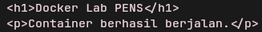
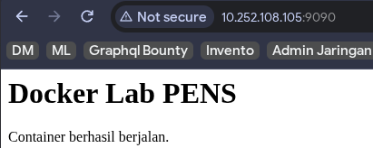
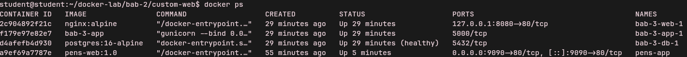
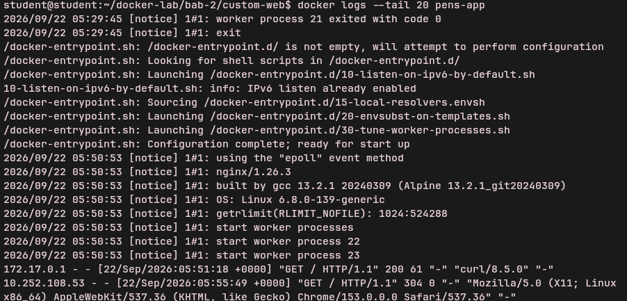
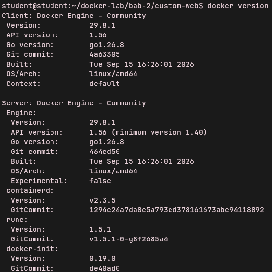
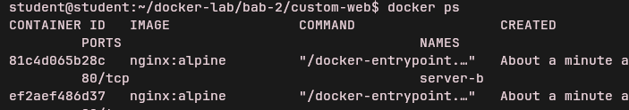
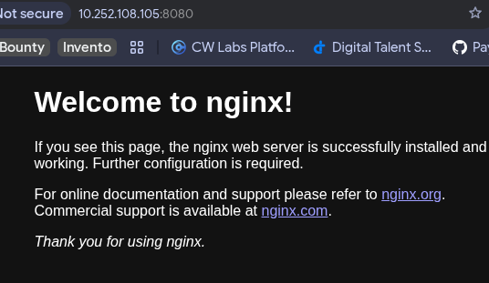
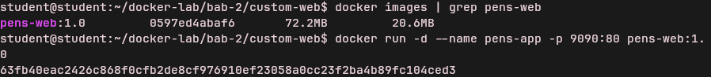
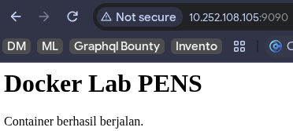

> **Lampiran Dokumen PDF:** [LAPORAN DevSecOps BAB-2.pdf](./docker-lab/bab-2/LAPORAN%20DevSecOps%20BAB-2.pdf)

<object data="./docker-lab/bab-2/LAPORAN%20DevSecOps%20BAB-2.pdf" type="application/pdf" width="100%" height="600px">
  
Pratinjau PDF tidak didukung oleh viewer. Buka tautan file: <a href="./docker-lab/bab-2/LAPORAN%20DevSecOps%20BAB-2.pdf">LAPORAN DevSecOps BAB-2.pdf</a>.

</object>

# **Praktikum 2 \- Konsep Container dan Instalasi Docker**

Topik utama: containerization, Docker Engine, Docker CLI, Docker Desktop, Dockerfile, image layer.

## **Install Docker & Docker Compose**

sudo pacman \-S docker docker-compose  
sudo systemctl enable \--now docker  
sudo usermod \-aG docker \$USER  
\# WAJIB: Logout dan Login ulang (atau restart) agar group docker aktif

## **Setup Directory**

mkdir \-p \~/devsecops-lab/bab-2/custom-web  
cd \~/devsecops-lab/bab-2  
docker run \-d \--name web-public \-p 8080:80 nginx:1.26-alpine  
cd custom-web

## **Dockerfile custom web statis**

cat \> index.html \<\< 'EOF'  
\<h1\>Docker Lab PENS\</h1\>  
\<p\>Container berhasil berjalan.\</p\>  
EOF

cat \> Dockerfile \<\< 'EOF'  
FROM nginx:1.26-alpine  
LABEL maintainer="admin@pens.ac.id"  
COPY index.html /usr/share/nginx/html/index.html  
EXPOSE 80  
CMD \["nginx", "-g", "daemon off;"\]  
EOF

* Screenshot hasil curl/browser/API/dashboard sesuai target bab.

docker build \-t pens-web:1.0 .  
docker run \-d \--name pens-app \-p 9090:80 pens-web:1.0  
curl http\://localhost:9090

* Screenshot docker compose ps atau docker ps yang menunjukkan service berjalan.

* Cuplikan log atau query yang membuktikan sistem bekerja.

### **Analisis wajib:**

1. Jelaskan satu masalah yang muncul dan cara Anda mendiagnosisnya.  
   * Tidak ada

2. Jelaskan risiko keamanan atau operasional yang relevan pada bab ini.  
   * Risiko keamanan utama adalah user yang masuk ke dalam grup docker memiliki hak akses yang secara praktis setara dengan root pada host, ditambah container yang berjalan secara default sebagai user root. Risiko operasionalnya adalah tidak adanya pembatasan resource (CPU dan memori), sehingga satu container yang mengalami error dapat menghabiskan seluruh sumber daya host dan mengganggu layanan lain.

3. Berikan rekomendasi perbaikan bila lab ini akan dibawa ke production-like environment.  
   * Untuk lingkungan production, image harus dibangun menggunakan multi-stage build dan dijalankan sebagai non-root user. Selain itu, container wajib dibatasi penggunaan resource-nya, menggunakan port binding yang spesifik (misalnya hanya ke 127.0.0.1), menerapkan filesystem read-only, serta wajib dilakukan pemindaian kerentanan (vulnerability scanning) sebelum proses deployment.

## **Verifikasi dan Skenario Pengujian**

\[✅\] Docker Engine aktif dan docker version menampilkan Client serta Server.  
  
\[✅\] User non-root dapat menjalankan docker ps tanpa sudo.  
  
\[✅\] Container Nginx dapat diakses dari browser melalui port host.  
  
\[✅\] Image pens-web:1.0 berhasil dibangun dan dijalankan.  
  
  
\[✅\] Mahasiswa dapat menjelaskan perbedaan EXPOSE dan \-p.  
EXPOSE untuk dokumentasi port apa yang dipakai dalam service itu dan ditaruh dalam Dockerfile. \-p digunakan untuk port forwarding, agar service bisa diakses dari host atau dari luar jaringan.

## **Evaluasi dan Latihan Mandiri**

1. Mengapa penggunaan tag latest tidak dianjurkan untuk deployment yang harus reproducible?  
   * Karena setiap build docker akan memanggil image dengan versi yang paling baru, kalau ternyata image baru ada masalah dengan kode yang lama, nanti malah membuat repot proses deployment.  
2. Jelaskan peran containerd dan runc dalam arsitektur Docker.  
   * containerd sebagai "Manajer Proyek" yang menerima perintah dari Docker CLI, mengelola image, dan mengatur jaringan. Sedangkan runc adalah "Tukang Bangunan" tingkat rendah yang benar-benar berbicara dengan Kernel Linux untuk membuat *namespace* dan *cgroup*. Pemisahan ini penting agar Docker Daemon tidak perlu memiliki hak akses rendah yang berbahaya.  
3. Apa konsekuensi keamanan dari memasukkan user ke group docker?  
   * Docker Daemon berjalan sebagai root. Socket komunikasi Docker (/var/run/docker.sock) memiliki izin baca/tulis untuk group docker. Jika user punya akses ke socket ini, user bisa mount seluruh filesystem host ke dalam container.  
4. Bandingkan layer image nginx:1.26-alpine dan image custom yang Anda buat.  
   * Image pens-web:1.0 hanya menambahkan 1 layer filesystem baru di atas base image, yang dihasilkan oleh instruksi COPY.  
5. Kapan sebaiknya memilih VM daripada container?  
   * Saat kita membutuhkan isolasi kuat, Multi OS, kode monolith, dan Kepatuhan Regulasi (Compliance) yang mensyaratkan isolasi tingkat hardware/kernel.
