**LAPORAN DevSecOps**  
**KELOMPOK 3 \- Lab 3 VM \- Ubuntu 24.04.3 LTS**

****

Nama			: Muhammad Rafi Putra Hidayat  
			  Hafidz Kurnia Darojad  
			  Indra Rahmat Maulidi  
NRP			: 3124600009  
			  3124600015  
			  3124600017  
Dosen Pengajar	: Ferry Astika Saputra, ST., M.Sc

**PROGRAM STUDI D4 TEKNIK INFORMATIKA**  
**POLITEKNIK ELEKTRONIKA NEGERI SURABAYA (PENS)**   
**TAHUN 2026**

> **Lampiran Dokumen PDF:** [LAPORAN DevSecOps BAB-3.pdf](./docker-lab/bab-3/LAPORAN%20DevSecOps%20BAB-3.pdf)

<object data="./docker-lab/bab-3/LAPORAN%20DevSecOps%20BAB-3.pdf" type="application/pdf" width="100%" height="600px">
  
Pratinjau PDF tidak didukung oleh viewer. Buka tautan file: <a href="./docker-lab/bab-3/LAPORAN%20DevSecOps%20BAB-3.pdf">LAPORAN DevSecOps BAB-3.pdf</a>.

</object>

# **User-defined bridge network**

Jalankan langkah berikut secara berurutan, lalu verifikasi hasil sebelum melanjutkan ke sub-langkah berikutnya. 

docker network create \--driver bridge \--subnet 172.20.0.0/16 lab-net  
docker run \-d \--name server-a \--network lab-net nginx:alpine  
docker run \-d \--name server-b \--network lab-net nginx:alpine  
docker exec server-a ping \-c 3 server-b  
docker rm \-f server-a server-b  
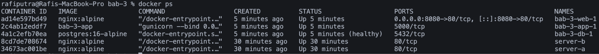

# **Volume backup dan restore**

Jalankan langkah berikut secara berurutan, lalu verifikasi hasil sebelum melanjutkan ke sub-langkah berikutnya. 

docker volume create data-vol  
docker run \-d \--name writer \-v data-vol:/app/data alpine:3.20   sh \-c "while true; do date \>\> /app/data/log.txt; sleep 5; done"  
sleep 15  
docker rm \-f writer  
docker run \--rm \-v data-vol:/data alpine:3.20 cat /data/log.txt  
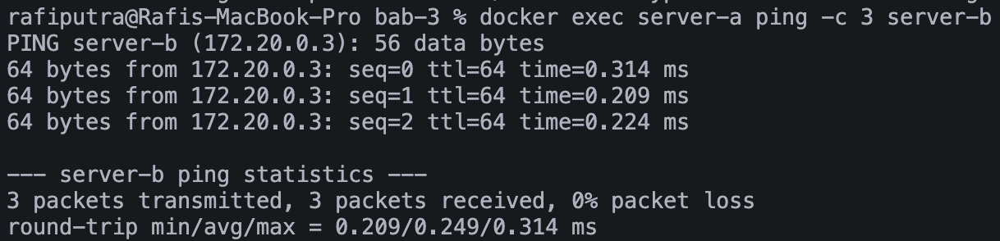  
docker run \--rm \-v data-vol:/source:ro \-v \$(pwd):/backup alpine:3.20   tar czf /backup/data-vol-backup.tar.gz \-C /source  
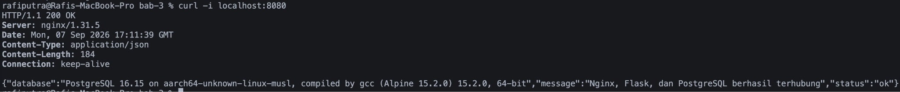

# **compose multi-container Nginx-Flask- PostgreSQL**

Arsitektur Laboratorium dan Prasyarat Lingkungan

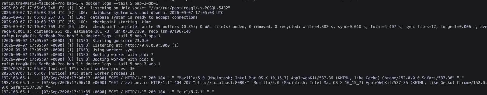

Struktur akhirnya  
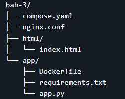  
Isi:  
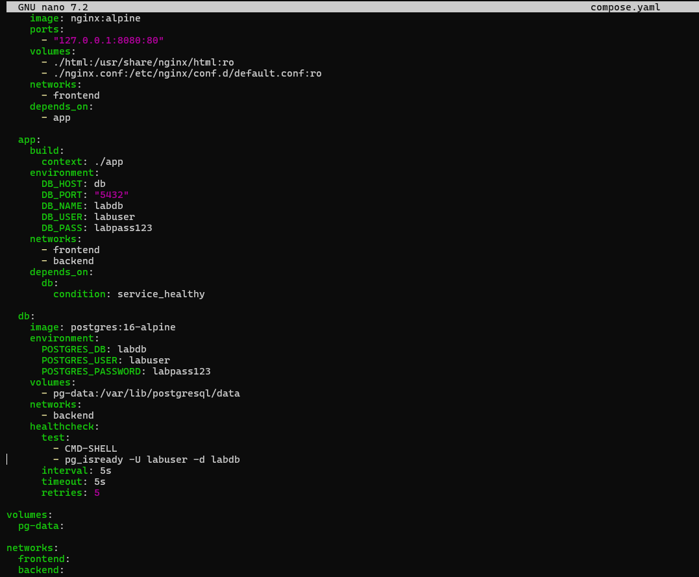  
Buat app/requirements.txt  
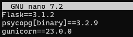

Buat app/[app.py](http://app.py):  
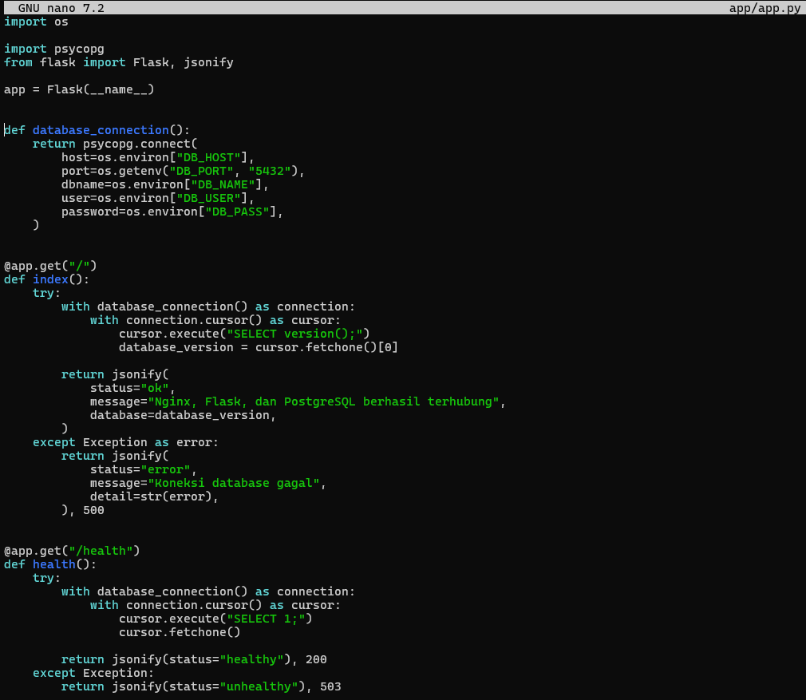  
Buat app/Dockerfile:  
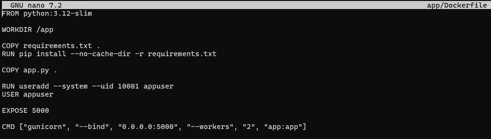  
Buat nginx.conf:  
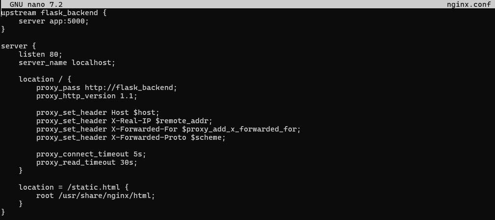  
Buat halaman statis index.html:  
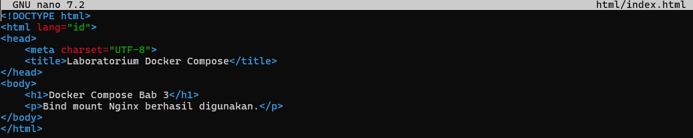  
Menjalankan Stack  
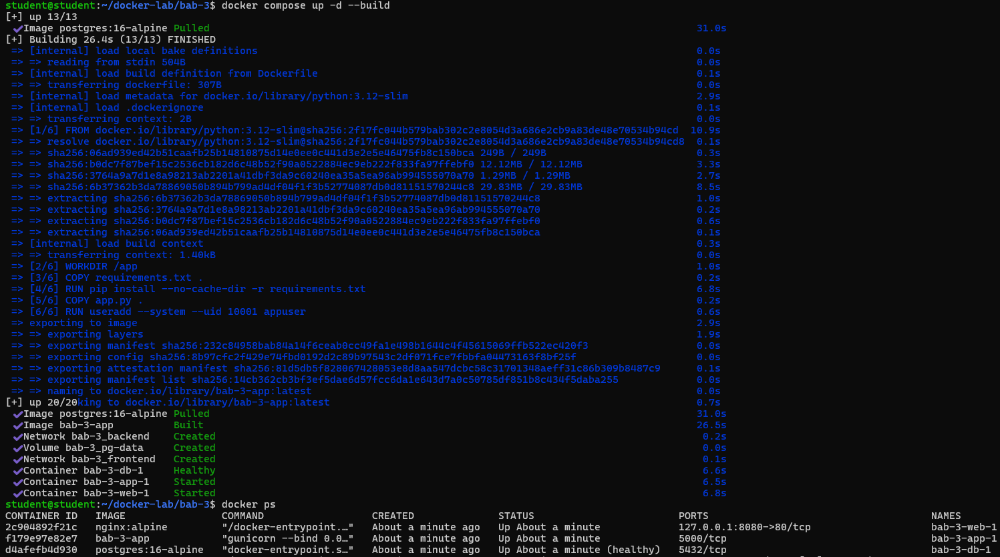

	

# **Verifikasi dan Skenario Pengujian**

\[✅\] Container di user-defined bridge dapat saling resolve menggunakan nama.

  
\[✅\] Data di named volume tetap ada setelah container dihapus.

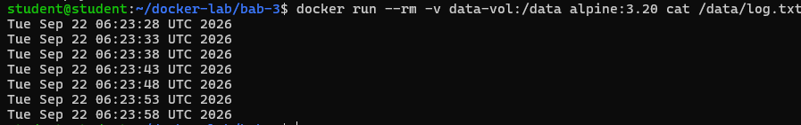

\[✅\] Bind mount menunjukkan perubahan file host tanpa rebuild image.

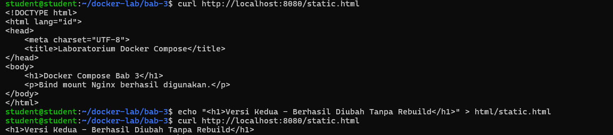

\[✅\] tmpfs kehilangan data setelah container restart.

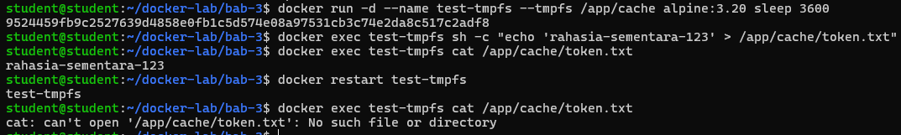

\[✅\] Compose stack web-app-db berjalan dan API health menampilkan koneksi database.

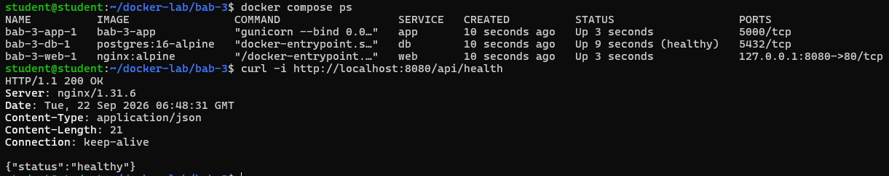

# **Evaluasi dan Latihan Mandiri**

1\. Mengapa user-defined bridge lebih baik daripada default bridge untuk multi-container app?

User-defined bridge menyediakan resolusi DNS otomatis berdasarkan nama service. Container dapat saling berkomunikasi menggunakan nama tanpa perlu mengetahui alamat IP dinamis yang bisa berubah. 

2\. Apa risiko bind mount terhadap keamanan host? 

Bind mount memberikan akses langsung ke sistem file host. Jika tidak dibatasi dengan flag read-only ( :ro ), proses di dalam container (terutama jika berjalan sebagai root) memiliki hak untuk memodifikasi, menimpa, atau menghapus file di host. Ini membuka celah keamanan yang serius, di mana penyerang yang berhasil masuk ke container dapat melakukan privilege escalation. 

3\. Apa perbedaan docker compose down dan docker compose down \-v? 

Docker compose down mematikan dan menghapus container dan network yang dibuat dalam project tapi tetap menyimpan volume. Flag \-v menyebabkan volume juga ikut terhapus. 

4\. Kapan depends\_on dengan healthcheck lebih tepat daripada depends\_on biasa? 

Saat butuh database untuk online dan jalan dengan normal terlebih dahulu (biasanya db butuh waktu untuk siap).

5\. Bagaimana strategi backup volume untuk database produksi? 

Menjalankan container sementara yang me-mount volume database tersebut, lalu mengeksekusi perintah dump native (misal pg\_dump ) untuk menghasilkan file backup yang konsisten secara logika. File backup tersebut kemudian harus dienkripsi dan dikirim ke penyimpanan eksternal yang terpisah (misal cloud S3).
