> **Lampiran Dokumen PDF:** [LAPORAN DevSecOps BAB-4.pdf](./docker-lab/bab-4/web-stack/LAPORAN%20DevSecOps%20BAB-4.pdf)

<object data="./docker-lab/bab-4/web-stack/LAPORAN%20DevSecOps%20BAB-4.pdf" type="application/pdf" width="100%" height="600px">
  
Pratinjau PDF tidak didukung oleh viewer. Buka tautan file: <a href="./docker-lab/bab-4/web-stack/LAPORAN%20DevSecOps%20BAB-4.pdf">LAPORAN DevSecOps BAB-4.pdf</a>.

</object>
  
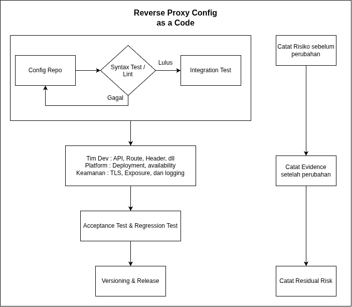

## **Verifikasi dan Skenario Pengujian**

\[ \] Nginx reverse proxy dapat mengakses Apache melalui nama service.

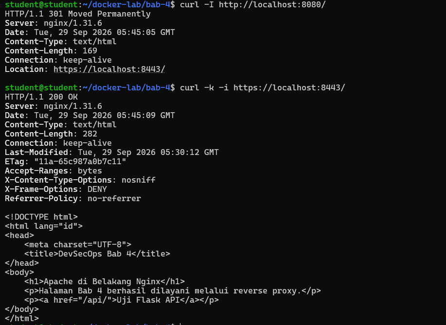

\[ \] Endpoint /api diarahkan ke backend Flask.

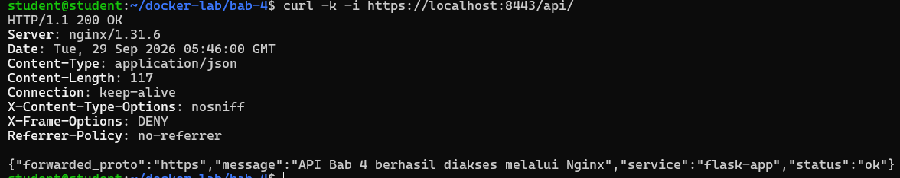

\[ \] HTTPS self-signed berjalan di port 8443\.

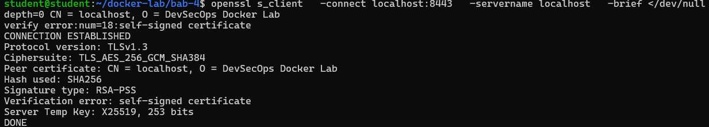

\[ \] Access log tersimpan di direktori host.

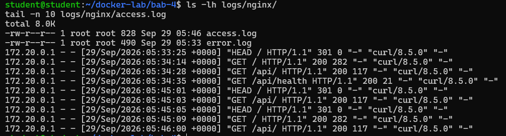

\[ \] Mahasiswa mampu menjelaskan alur request client-proxy-backend.

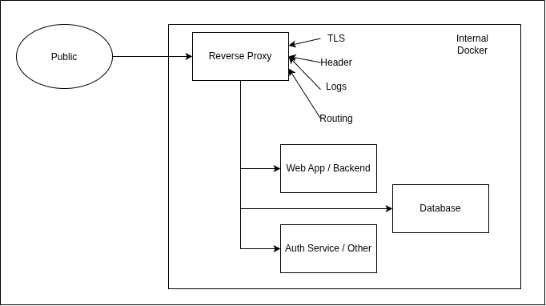

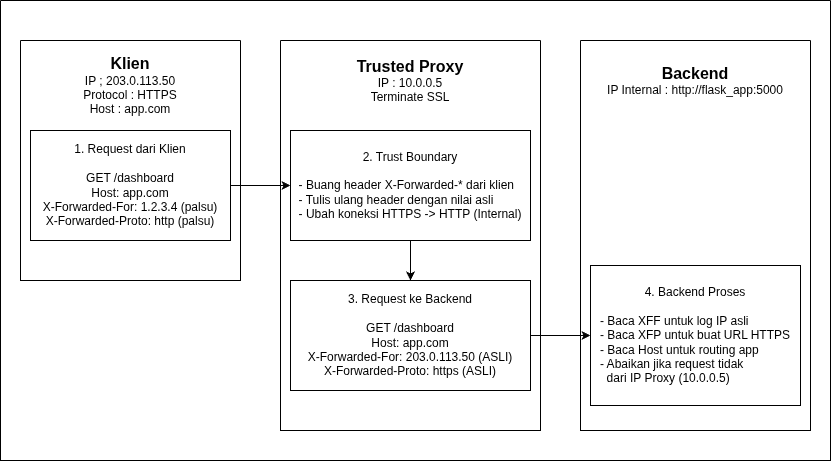

## **Evaluasi dan Latihan Mandiri**

1. Mengapa reverse proxy tidak seharusnya menjalankan semua logic aplikasi?  
- Pemisahan Peran: Reverse proxy fokus mengelola lalu lintas jaringan (TLS termination, routing, rate limiting, caching), bukan aturan bisnis aplikasi.  
- Performa Arsitektur: Nginx berbasis event-driven non-blocking. Eksekusi komputasi berat atau query database lambat di proxy akan menahan worker process dan menurunkan kecepatan akses seluruh pengguna.  
- Keamanan: Memisahkan lapisan depan mencegah kerentanan kode aplikasi langsung merusak kontrol gerbang routing utama.

2. Apa perbedaan TLS termination dan end-to-end TLS?  
- TLS Termination: Lalu lintas didekripsi di reverse proxy; komunikasi dari proxy ke backend menggunakan HTTP biasa. Praktis dan menghemat beban CPU backend, tetapi segmen jaringan internal tidak terenkripsi.  
- End-to-End TLS: Enkripsi dipertahankan dari klien langsung hingga ke backend (atau dienkripsi ulang dari proxy via mTLS). Menerapkan prinsip Zero Trust sehingga aman dari penyadapan internal, meski membutuhkan beban komputasi dan pengelolaan sertifikat di setiap service.

3. Bagaimana cara mengisolasi backend agar tidak langsung diakses dari host?  
- Hapus deklarasi ports: Jangan memetakan port host ke backend pada compose.yaml.  
- Gunakan User-Defined Bridge Network: Letakkan proxy dan backend dalam satu network privat yang sama. Nginx memanggil backend via DNS internal Docker (http\://flask-app:5000), sementara interface host sama sekali tidak membuka port tersebut.  
    
4. Apa konsekuensi menyimpan private key TLS di bind mount?  
- Kebocoran Git: Rentan terunggah ke repositori publik jika lupa dimasukkan ke .gitignore.  
- Akses Izin Host: User non-root di sistem operasi host berpotensi membaca file kunci jika hak akses tidak dikunci (chmod 600).  
- Risiko Modifikasi: Jika tidak di-mount dengan flag read-only (:ro), kontainer yang terkompromi dapat mengubah atau merusak kunci di host.  
- Solusi: Solusinya adalah mengunci private key di host (chmod 600), mengecualikannya dari Git via .gitignore, lalu memasangnya ke Nginx saat runtime sebagai volume read-only (:ro) atau Docker Secret. Rotasi sertifikat dilakukan cukup dengan perintah nginx \-s reload tanpa rebuild image, sementara keamanan TLS dioptimalkan lewat protokol minimum TLSv1.2 TLSv1.3

5. Bandingkan log Nginx dan log Apache dari sisi format dan kegunaan debugging.  
- Nginx Log: Unggul untuk debugging jaringan dan gateway. Formatnya padat dan langsung menunjukkan akar masalah reverse proxy, seperti kegagalan upstream (502/504), negosiasi SSL, dan latensi proxy.  
- Apache Log: Unggul untuk debugging modul dan file server. Formatnya mencantumkan nama modul spesifik, berguna mendiagnosis error izin file sistem, aturan .htaccess, dan konfigurasi virtual host internal.

## **Bukti minimum:**

Screenshot docker compose ps atau docker ps yang menunjukkan service berjalan.

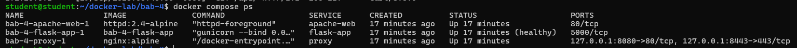

Screenshot hasil curl/browser/API/dashboard sesuai target bab.

- Uji HTTP

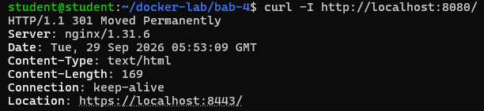

- Uji HTTPS

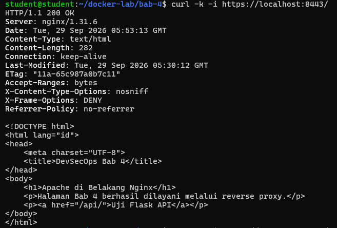

- Uji Flask API via HTTPS

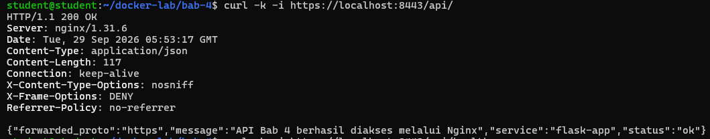

- Uji Health check

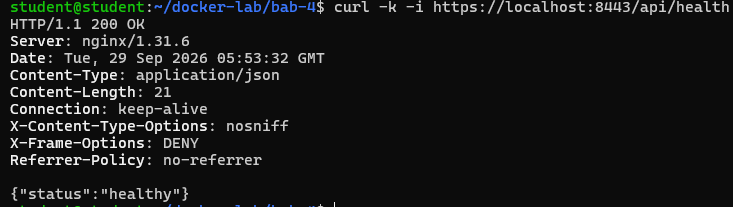  
Cuplikan log atau query yang membuktikan sistem bekerja.

## **Analisis Wajib**

**Jelaskan satu masalah yang muncul dan cara Anda mendiagnosisnya.**

Jawab : Tidak ada.

**Jelaskan risiko keamanan atau operasional yang relevan pada bab ini.**

Jawab : Penyimpanan Private Key di Bind Mount. File certs/lab.key yang disimpan di bind mount host dapat dibaca oleh user lain di sistem host jika hak akses (file permission) tidak dikunci (misal 600).

**Berikan rekomendasi perbaikan bila lab ini akan dibawa ke production-like environment.**

Jawab : Hindari menyimpan private key di bind mount biasa. Gunakan fitur Docker Secrets, Kubernetes Secrets, atau Vault Service lain dengan mode pemuatan read-only saat runtime.
