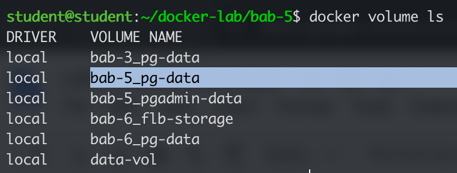
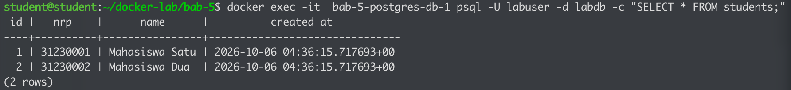
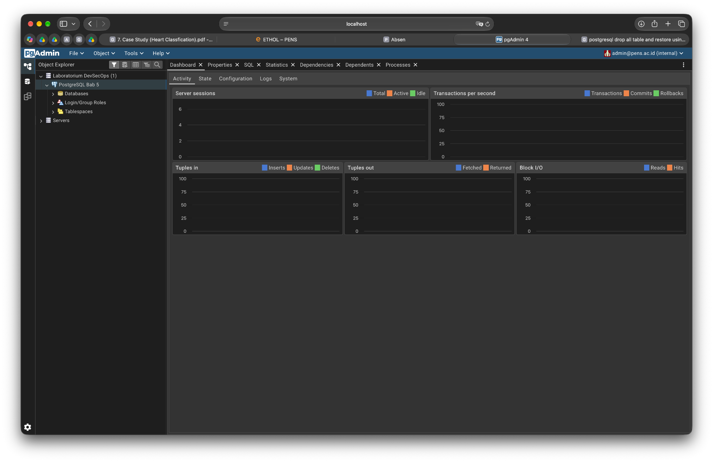
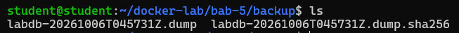
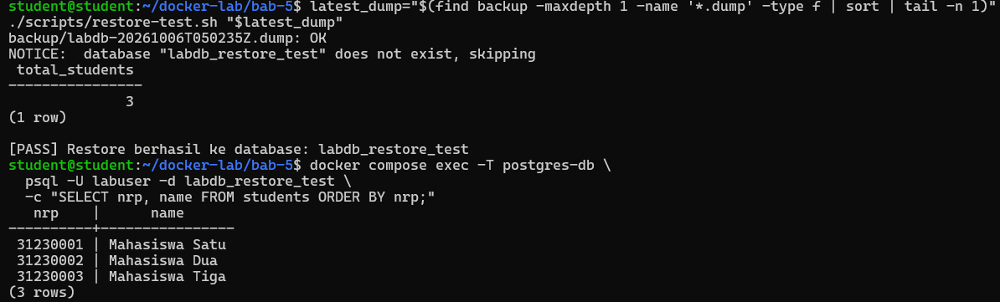
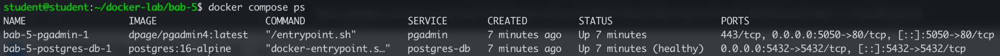
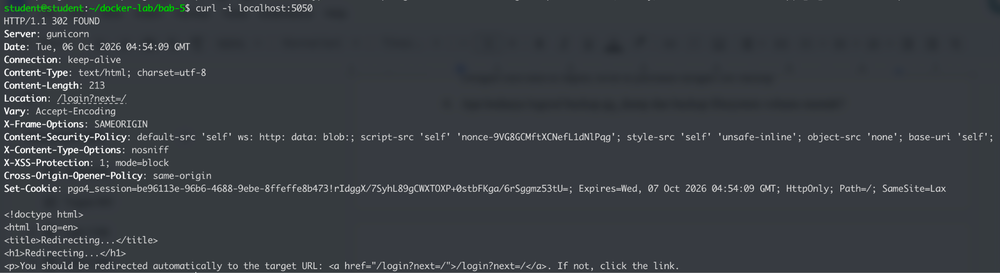
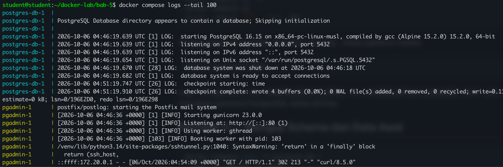

> **Lampiran Dokumen PDF:** [LAPORAN DevSecOps BAB-5.pdf](./docker-lab/bab-5/LAPORAN%20DevSecOps%20BAB-5.pdf)

<object data="./docker-lab/bab-5/LAPORAN%20DevSecOps%20BAB-5.pdf" type="application/pdf" width="100%" height="600px">
  
Pratinjau PDF tidak didukung oleh viewer. Buka tautan file: <a href="./docker-lab/bab-5/LAPORAN%20DevSecOps%20BAB-5.pdf">LAPORAN DevSecOps BAB-5.pdf</a>.

</object>

## **Verifikasi dan Skenario Pengujian**

\[ \] PostgreSQL berjalan dengan volume pg-data.

\[ \] Tabel students dibuat otomatis dari init script.

\[ \] pgAdmin dapat login dan terkoneksi ke database.

\[ \] Backup menghasilkan file dump di direktori host.

\[ \] Restore sudah diuji, bukan hanya diasumsikan berhasil.

## **Evaluasi dan Latihan Mandiri**

1. Mengapa init script tidak dijalankan ulang saat volume lama masih ada?

   Karena PostgreSQL hanya menjalankan script inisialisasi jika direktori data database kosong. Jika volume sudah ada dan berisi data, proses inisialisasi dilewati untuk mencegah penimpaan data yang sudah ada.

2. Apa risiko menaruh password database pada docker-compose.yml?

   Ketika di push di repo bisa terlihat, lebih baik dijadikan satu di file .env juga mempermudah maintenance

3. Bagaimana cara membuktikan backup dapat dipulihkan?

   Dengan cara data di hapus, terus di pulihkan dengan file backup

4. Apa bedanya logical backup pg\_dump dan backup filesystem volume mentah?

   pg\_dump melakukan backup secara logis (menghasilkan perintah SQL atau arsip terstruktur yang independen terhadap penyimpanan fisik), sedangkan backup filesystem menyalin direktori data fisik secara langsung di level sistem file.

5. Apa dampak docker compose down \-v terhadap database?

   Volumenya di hapus, data di database akan hilang karena container di mount di situ

   

## **Bukti minimum:**

* Screenshot docker compose ps atau docker ps yang menunjukkan service berjalan.

  

* Screenshot hasil curl/browser/API/dashboard sesuai target bab.

  

* Cuplikan log atau query yang membuktikan sistem bekerja.

  

## **Analisis wajib:**

1. Jelaskan satu masalah yang muncul dan cara Anda mendiagnosisnya.  
   * Masalah: Halaman UI pgAdmin tidak dapat diakses secara langsung menggunakan IP Virtual Machine (VM).  
   * Diagnosis & Solusi: Setelah memeriksa konfigurasi jaringan dan konektivitas antarmuka VM, masalah ditangani dengan melakukan SSH port forwarding / reverse port tunneling dari port VM ke PC lokal (localhost:5050), sehingga dashboard pgAdmin dapat dibuka dengan aman melalui browser di PC lokal.  
2. Jelaskan risiko keamanan atau operasional yang relevan pada bab ini.  
   * Risiko Keamanan:  
     * Penyimpanan kredensial/password database secara plain text di dalam file docker-compose.yml berisiko bocor apabila file ter-push ke repositori publik/VCS.  
     * Port komunikasi PostgreSQL (5432) dan pgAdmin dipublikasikan tanpa sertifikat enkripsi SSL/TLS, berisiko terkena serangan penyadapan (Man-in-the-Middle).  
   * Risiko Operasional:  
     * Eksekusi perintah docker compose down \-v secara tidak sengaja akan menghapus volume terikat (pg-data), menyebabkan kehilangan data permanen.  
     * Ketergantungan pada proses backup manual tanpa pengujian pemulihan (restore test) berkala berpotensi menyebabkan kegagalan saat insiden disaster recovery.  
3. Berikan rekomendasi perbaikan bila lab ini akan dibawa ke production-like environment.

   Tidak ada
