## **Quick start**

cd pmb-devsecops-lab  
./scripts/setup.sh  
./scripts/validate.sh  
docker compose up \-d \--build

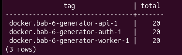

Alur kerja scripts/setup.sh:

1. Set direktori: Pindah working directory ke root project.  
2. Generasi .env:  
   1. Cek file .env. Jika sudah ada, pertahankan.  
   2. Jika belum ada: salin dari .env.example, set izin 600 (hanya owner).  
   3. Generate string acak 48-hex via openssl / python3 secrets untuk 5 secret:  
   4. APP\_DB\_ADMIN\_PASSWORD  
   5. APP\_DB\_WRITER\_PASSWORD  
   6. LOG\_DB\_ADMIN\_PASSWORD  
   7. LOG\_DB\_WRITER\_PASSWORD  
   8. SESSION\_SECRET  
3. Set permission script: Jalankan chmod \+x untuk init-app/01-init-app.sh, init-log/01-init-log.sh, dan seluruh file scripts/\*.sh.  
4. Output CLI: Tampilkan credential lab default (student / StudentLab\!2026) dan perintah langkah berikutnya (make validate && make up).

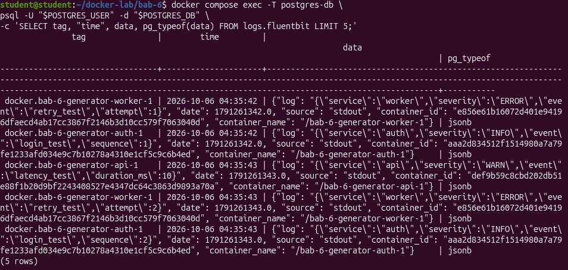

1. Can't list 'tests': Python compileall cari direktori tests/ di root. Tidak ada (lokasi asli di app/tests/). Kompilasi fallback ke app/. Normal, bukan error fatal.  
2. ModuleNotFoundError: No module named 'yaml': Script validasi butuh library PyYAML untuk parse compose.yaml. Python sistem belum ada modul tersebut. Eksekusi stop.

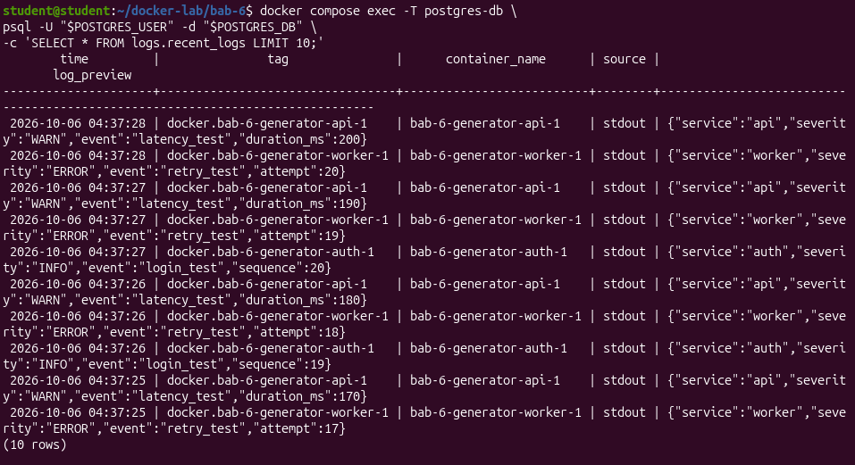

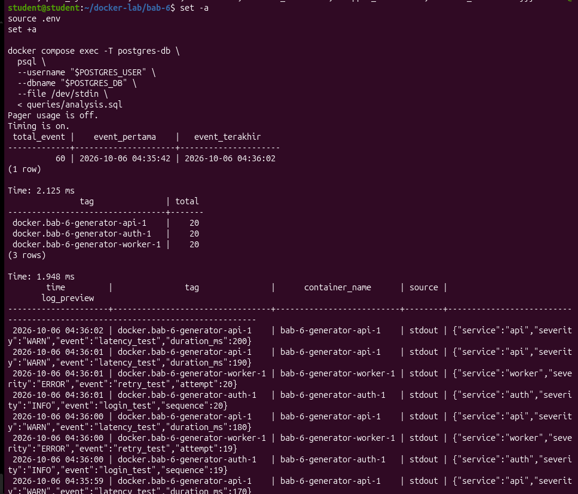

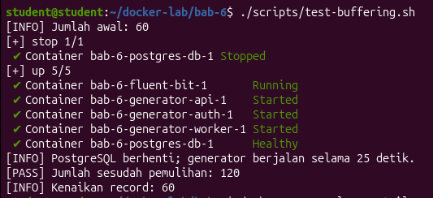

1. Install python3.13-venv, buat virtual environment .venv, aktifkan, install pyyaml via pip.

Alasan memakai .venv:

1. Proteksi OS (PEP 668): Linux modern (Ubuntu/Debian) blokir pip install di level sistem (externally-managed-environment). Mencegah file apt rusak tertimpa library Python manual.  
2. Isolasi dependensi: Library (pyyaml, dll.) terisolasi di direktori project. Hindari konflik versi dengan script bawaan OS atau project lain.  
3. Keamanan permission: Tanpa hak root/sudo. Modifikasi library terbatas dalam folder .venv.

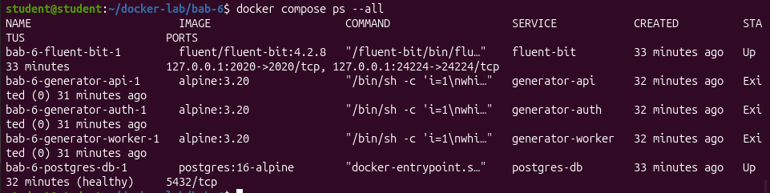

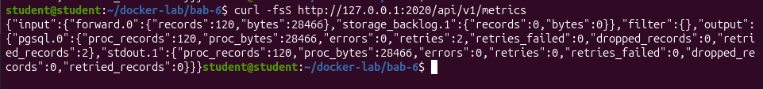

Tunggu hingga service sehat:

docker compose ps  
curl \-fsS http\://127.0.0.1:8080/healthz  
curl \-fsS [http\://127.0.0.1:2020/api/v1/health](http://127.0.0.1:2020/api/v1/health)  
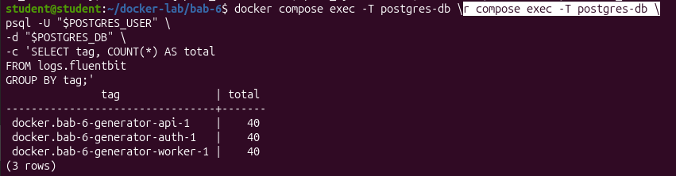

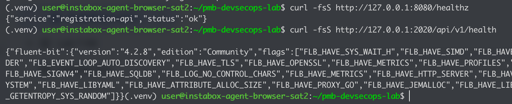  
Buka http\://127.0.0.1:8080 pada browser.

Username : student

Password : StudentLab\!2026

setup.sh membuat .env dengan credential database dan session secret acak. Jangan memasukkan .env ke repository atau laporan.

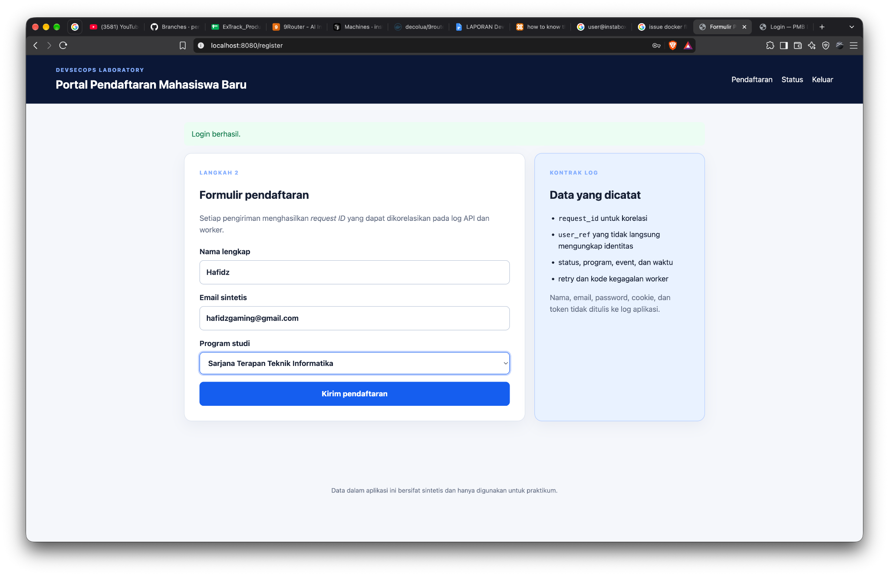  
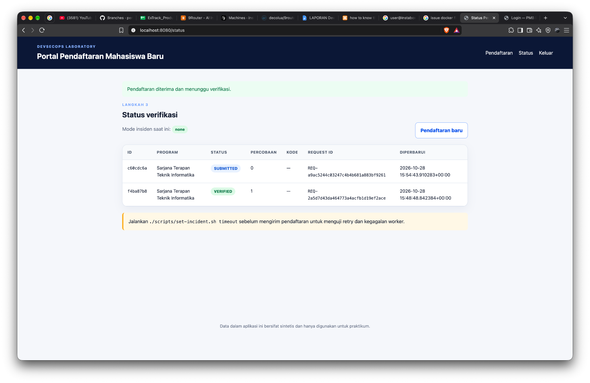

## **Skenario 1 — Alur normal**

Jalankan otomatis:

./scripts/demo-normal.sh

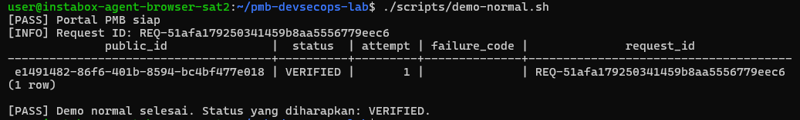

Alur kerja scripts/demo-normal.sh:

- set \-Eeuo pipefail, cd, load\_env : mengatur mode penanganan error, berpindah ke root project serta menjalankan scripts/lib.sh dan .env  
- wait\_http : menunggu hingga service berjalan normal  
- set-incident.sh : Mengirimkan data pendaftaran baru dengan tipe NORMAL dan mengambil serta menyimpan request\_id yang dihasilkan dari respons tersebut  
- docker compose exec ... psql : Menjalankan query SQL langsung ke database PostgreSQL (app-db) untuk memeriksa status data pendaftaran berdasarkan request\_id yang baru saja dibuat. Data yang ditampilkan meliputi public\_id, status, attempt, failure\_code, dan request\_id

## **Skenario 2 — Timeout dependency**

Jalankan otomatis:

./scripts/demo-incident.sh

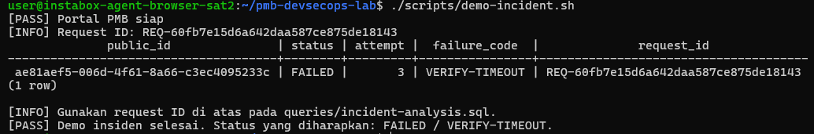

Alur kerja scripts/demo-incident.sh: 

- set-incident.sh timeout : Mengubah mode simulasi gangguan pada sistem menjadi timeout. Hal ini akan membuat proses verifikasi pendaftaran mengalami kendala atau waktu habis (*timeout*) pada dependensi eksternal/worker.  
- submit\_application INCIDENT : Mengirimkan data pendaftaran baru dengan tipe INCIDENT dan menangkap request\_id yang dihasilkan dari transaksi tersebut  
- docker compose exec ... psql : menjalankan query SQL yang mirip dengan demo normal  
- Memberikan informasi untuk menggunakan request\_id tsb

## **Menelusuri request ID**

Setiap respons aplikasi membawa header X-Request-ID. Nilainya juga disimpan pada transaksi dan event log.

Tampilkan transaksi:

set \-a; source .env; set \+a  
docker compose exec \-T app-db \\  
  psql \-U "\$APP\_DB\_ADMIN\_USER" \-d "\$APP\_DB\_NAME" \\  
  \-c 'SELECT public\_id, status, attempt, failure\_code, request\_id FROM registrations ORDER BY submitted\_at DESC;'  
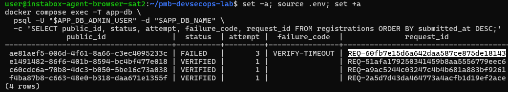

Salin salah satu request ID, kemudian ubah variabel investigated\_request\_id pada queries/incident-analysis.sql dan jalankan: 

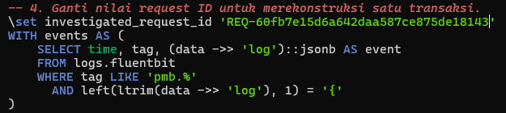

docker compose exec \-T log-db \\  
  psql \-U "\$LOG\_DB\_ADMIN\_USER" \-d "\$LOG\_DB\_NAME" \\  
  \--file=/dev/stdin \< queries/incident-analysis.sql  
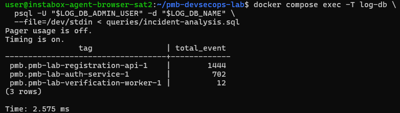  
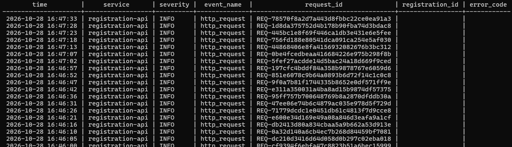  
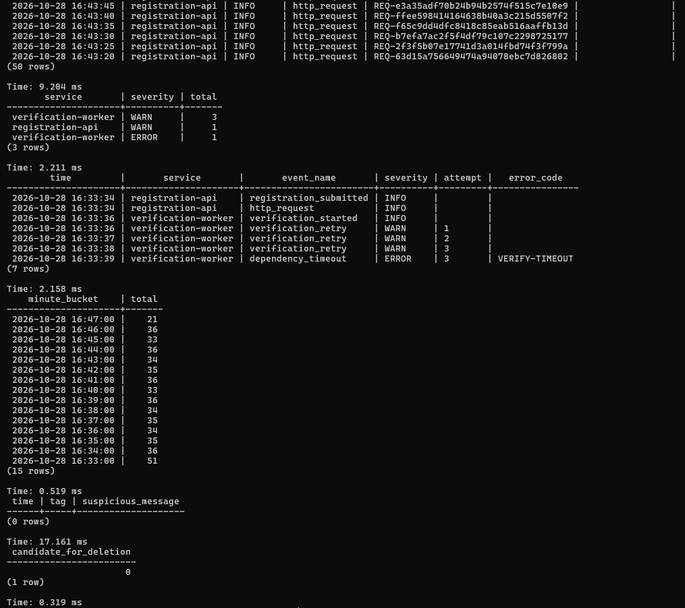

## **Pengujian pipeline**

Verifikasi umum:

./scripts/verify.sh

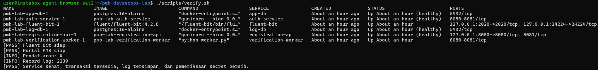

Alur kerja scripts/verify.sh:

- app\_rows**,** log\_rows :   
* Menghitung jumlah total data pendaftaran di database aplikasi (app-db).  
* Menghitung jumlah total log terpusat yang masuk ke database log (log-db) melalui Fluent Bit.  
* Jika jumlah transaksi atau log kurang dari 1, script akan menghentikan proses (exit 1) dan memberikan peringatan untuk menjalankan demo normal/insiden terlebih dahulu.  
- suspicious :   
* Menjalankan kueri SQL pada penyimpanan log terpusat untuk mendeteksi apakah ada informasi sensitif atau rahasia yang tidak sengaja tercatat di dalam log (seperti password, authorization, bearer, cookie, session\_secret, atau api\_key).  
* Jika ditemukan adanya data sensitif (suspicious \> 0), script akan menggagalkan verifikasi untuk mencegah kebocoran informasi.  
- Jika semua pemeriksaan berhasil, script akan menampilkan pesan sukses

Unit test redaction dan request ID: 

docker compose run \--rm \--no-deps registration-api \\  
  python \-m unittest discover \-s tests \-v  
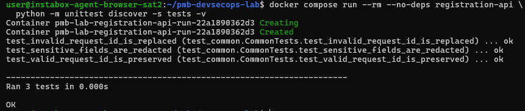

digunakan untuk menjalankan unit test secara otomatis di dalam container layanan registration-api tanpa memuat container dependensinya (--no-deps)

## **Evidence**

./scripts/collect-evidence.sh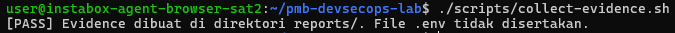  
Alur kerja ./scripts/[collect-evidence.sh](http://collect-evidence.sh) : 

- Membuat folder reports/ jika belum ada untuk menyimpan seluruh file bukti.

- Menyimpan daftar dan status berjalan seluruh kontainer Docker Compose ke dalam file reports/compose-ps.txt

- Mengambil data metrik performa/layanan dari API Fluent Bit (http\://127.0.0.1:2020/api/v1/metrics) dan menyimpannya dalam format JSON di reports/fluent-bit-metrics.json

- Menjalankan kueri SQL pada database aplikasi (app-db) untuk mengekstrak seluruh data pendaftaran (public\_id, status, attempt, failure\_code, request\_id, updated\_at) yang diurutkan berdasarkan waktu kirim, lalu menyimpannya ke reports/registration-status.txt

- Menjalankan perintah/kueri SQL pada database log terpusat (log-db) melalui standard input (stdin) untuk memproses atau menyimpan data pencatatan log.

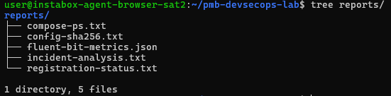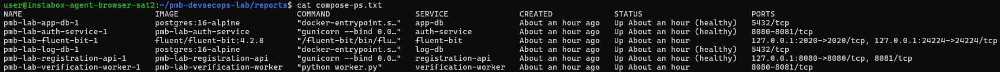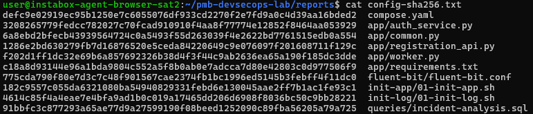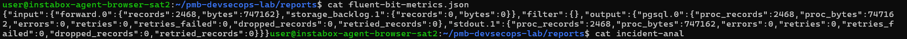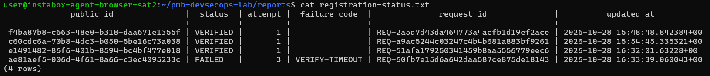

## **Pertanyaan**

**Kapan kita memakai fluentbit, kapan kita memakai prometheus?**

Perbedaan utama ada pada jenis data telemetri: Fluent Bit untuk LOGS (kejadian diskrit/teks), Prometheus untuk METRICS (angka deret waktu/time-series).

 GUNAKAN FLUENT BIT (Bab 6 — Centralized Logging) SAAT:

1. Mengumpulkan event diskrit per kejadian (baris stdout/stderr container, error stack trace, audit trail login, request detail).

2. Butuh konteks kardinalitas tinggi (user\_id, request\_id, IP, pesan error spesifik, payload JSON).

3. Container bersifat ephemeral dan log perlu diparsing, difilter, lalu dikirim (push/forward) ke penyimpanan terpusat seperti PostgreSQL JSONB, Loki, atau Elasticsearch untuk forensik dan debugging.

4. Menjawab pertanyaan: "Mengapa error ini terjadi dan pesan/baris kode mana penyebabnya?"

 GUNAKAN PROMETHEUS (Bab 7 — Monitoring Metrics) SAAT:

1. Mengukur kondisi numerik sistem secara periodik (CPU, RAM, disk, network I/O, jumlah request/detik, latensi p95, status up/down).

2. Mengambil data berkala (pull/scrape) dari endpoint /metrics milik exporter (Node Exporter untuk host, cAdvisor untuk container) dan menyimpannya di Time-Series Database (TSDB).

3. Menghitung tren dan agregasi matematis dengan PromQL (rate, sum, avg, histogram) untuk memantau SLI/SLO, Golden Signals, dan memicu alert ambang batas.

4. Menjawab pertanyaan: "Kapan sistem mulai melambat, seberapa tinggi bebannya, dan komponen mana yang mengalami gejala?"

POLA PENGGUNAAN BERSAMA (Bab 6 \+ Bab 7 di Grafana):

Prometheus mendeteksi gejala lebih dulu (misal alert lonjakan HTTP 500 atau CPU 95% pada jam 10:05), lalu Fluent Bit dipakai menelusuri akar penyebabnya melalui isi log detail pada rentang waktu yang sama.

## **Pertanyaan analitis**

1. Mengapa status container Up tidak membuktikan fungsi bisnis sehat?

   Status Up hanya berarti proses utama (PID 1\) container masih berjalan. Status itu tidak menjawab apakah aplikasi benar-benar melayani request dengan benar.

   Healthcheck yang hanya memeriksa availability pun belum cukup. Fungsi bisnis perlu diverifikasi lewat indikator yang lebih dalam. Readiness check yang menguji dependency, synthetic transaction, metric error rate dan latency, serta log yang menunjukkan hasil transaksi.

   

2. Apa perbedaan event time, waktu penerimaan collector, dan waktu penyimpanan database?

| Waktu | Dicatat oleh | Keterangan |
| :---- | :---- | :---- |
| Event time | Aplikasi (producer) | Saat peristiwa benar-benar terjadi |
| Collector receive time | Fluent Bit | Saat record diterima atau diproses oleh collector |
| Database insert time | PostgreSQL | Saat row benar-benar ditulis ke tabel (misalnya DEFAULT now()) |

   Urutannya: event time ≤ receive time ≤ insert time. Selisihnya muncul karena buffering, retry, batching (Flush 5), mode async, atau output yang sementara down. Pada konfigurasi lab, kolom time diisi dari Timestamp\_Key time, yaitu waktu yang dibuat oleh collector, bukan waktu kejadian asli di aplikasi. Praktik yang baik adalah menyimpan ketiganya, memakai UTC, dan menyinkronkan jam host (NTP).

   

3. Mengapa nama dan email tidak dimasukkan ke structured log?

   1. Minimisasi data: hanya field yang diperlukan untuk operasi, keamanan, kepatuhan, atau analisis yang boleh disimpan.  
   2. Data pribadi (PII): nama dan email dapat mengidentifikasi individu, sehingga masuk cakupan regulasi seperti UU PDP dan GDPR.  
   3. Perluasan permukaan risiko: log biasanya diakses banyak pihak (developer, analyst, tim platform), dikirim ke banyak tempat, dan disimpan lama. Kebocoran log menjadi kebocoran data pribadi.  
   4. Sulit dihapus: PII yang sudah tersebar di backup, ekspor, dan indeks sulit ditarik kembali saat ada permintaan penghapusan.

4. Apa risiko penggunaan request\_id dari client tanpa validasi?

   1. Log injection / forging: client dapat menyisipkan karakter newline atau JSON palsu sehingga muncul entri log palsu atau struktur record rusak.  
   2. Pemalsuan korelasi: penyerang memakai ID milik request lain untuk mengacaukan penelusuran atau menyembunyikan jejaknya.  
   3. Tabrakan ID (collision): ID duplikat membuat dua transaksi berbeda tampak seperti satu.  
   4. Kerusakan kualitas data: panjang berlebihan membebani storage dan indeks, format tidak konsisten merusak parser dan dashboard.  
   5. Nilai evidence menurun: untuk audit, ID yang dikendalikan pihak luar tidak bisa dipercaya.

5. Apa yang terjadi bila buffer Fluent Bit mencapai batas 256 MB?

   1. Buffer memori penuh (Mem\_Buf\_Limit): input dijeda (paused) sementara. Untuk input tertentu data baru bisa hilang jika sumbernya tidak bisa menunggu.  
   2. Buffer filesystem penuh (storage.max\_chunks\_up atau batas disk): chunk lama atau baru bisa di-drop sesuai kebijakan, atau disk bisa penuh jika tidak dibatasi.  
   3. Backpressure ke Docker: jika mode logging driver blocking (tanpa fluentd-async: "true"), container producer bisa tertahan. Pada mode async, record dibuang atau di-buffer di sisi Docker dengan batas tertentu, sehingga log dapat hilang.

6. Bagaimana mendeteksi duplikasi record setelah retry?

   1. Event ID unik dari producer (UUID atau hash dari service \+ timestamp \+ sequence \+ isi), lalu simpan di field event\_id.  
   2. Unique constraint pada database, misalnya UNIQUE (event\_id) dengan INSERT ... ON CONFLICT DO NOTHING agar insert menjadi idempoten.  
   3. Sequence number per sumber untuk mendeteksi baik duplikasi maupun gap (record hilang).  
   4. Metric retry dari Fluent Bit sebagai indikator awal kemungkinan duplikasi.

7. Kapan PostgreSQL tidak lagi sesuai sebagai backend log utama?

   1. Volume ingest tinggi dan kontinu: write amplification, WAL, dan bloat membebani database.  
   2. Retensi panjang dengan data sangat besar: indeks GIN pada JSONB membengkak, query melambat, dan VACUUM serta penghapusan massal mahal.  
   3. Pencarian teks bebas (full-text) skala besar atau agregasi lintas jutaan hingga miliaran record.  
   4. Kebutuhan real-time seperti dashboard dan alerting dengan latency rendah.  
   5. Biaya storage: penyimpanan relasional lebih mahal daripada object storage atau sistem kolumnar terkompresi.  
   6. Kebutuhan multi-tenant dan skala horizontal yang sulit dipenuhi satu node PostgreSQL.

   

8. Kontrol apa yang harus ditambahkan sebelum arsitektur serupa dipakai pada produksi?

   **Keamanan dan kerahasiaan**

* Hapus kredensial hardcoded (labpass123), gunakan secret manager atau Docker secrets.  
* Aktifkan TLS antara Docker, Fluent Bit, dan PostgreSQL, jangan expose port 24224 ke jaringan luas.  
* Pisahkan credential: akun writer (INSERT saja) dan akun analyst (read-only), terapkan least privilege.  
* Redaction PII dan secret di producer, diverifikasi ulang di collector.  
* Audit akses query administratif dan perubahan tabel.

  **Reliability**

* Buffer berbasis disk dengan batas jelas, kebijakan retry, dan penanganan dead-letter untuk record gagal parse.  
* Replikasi, backup, dan recovery exercise untuk database serta collector (hindari single point of failure).  
* Healthcheck yang menguji fungsi nyata, bukan hanya status Up.

  **Kualitas data**

* Kontrak schema log, validasi request\_id, event\_id unik, timestamp UTC, dan sinkronisasi NTP.  
* Versi schema dan pengujian perubahan field seperti perubahan API.
