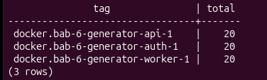
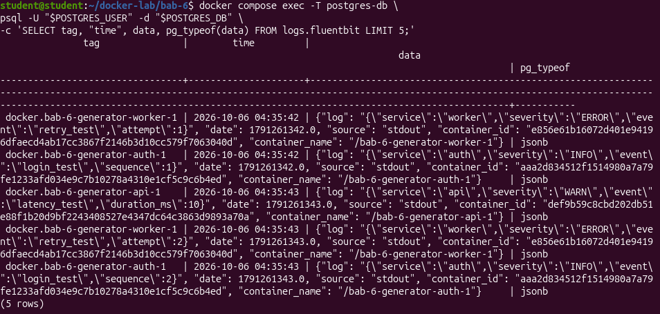
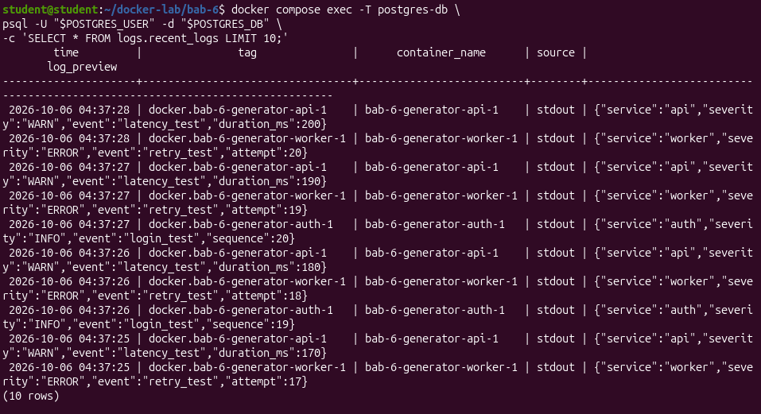
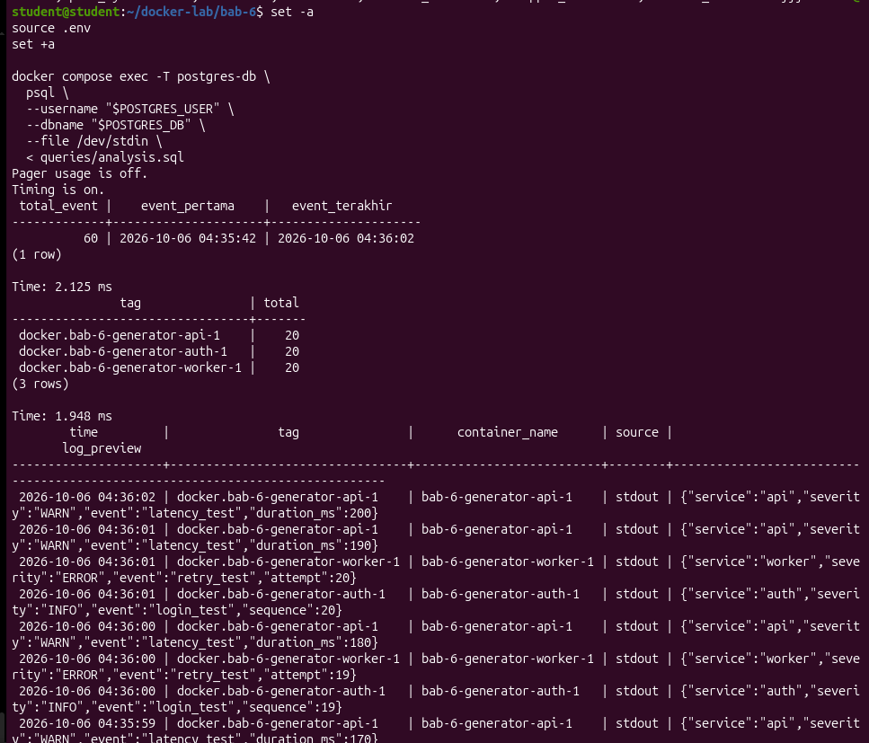
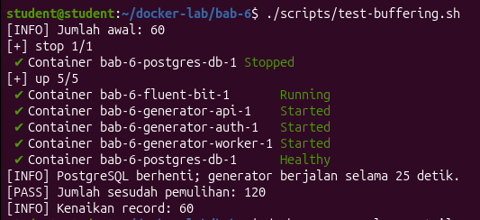
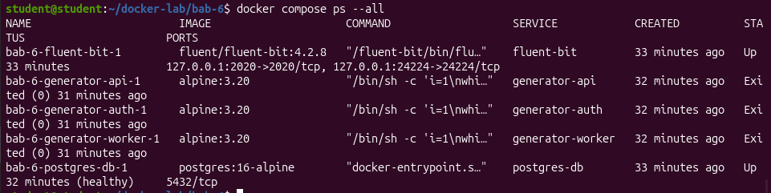
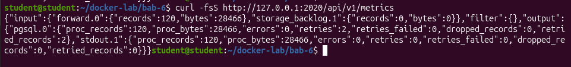
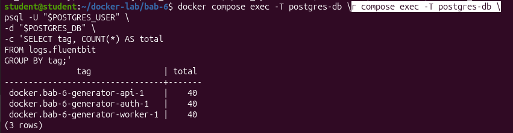

> **Lampiran Dokumen PDF:** [LAPORAN DevSecOps BAB-6.pdf](./docker-lab/bab-6/LAPORAN%20DevSecOps%20BAB-6.pdf)

<object data="./docker-lab/bab-6/LAPORAN%20DevSecOps%20BAB-6.pdf" type="application/pdf" width="100%" height="600px">
  
Pratinjau PDF tidak didukung oleh viewer. Buka tautan file: <a href="./docker-lab/bab-6/LAPORAN%20DevSecOps%20BAB-6.pdf">LAPORAN DevSecOps BAB-6.pdf</a>.

</object>

## **Verifikasi dan Skenario Pengujian**

\[ \] Fluent Bit menerima log dari minimal tiga container.  
  
\[ \] Tabel logs.fluentbit berisi data dengan tag, time, dan data JSONB.  
  
\[ \] View recent\_logs menampilkan log terbaru.  
  
\[ \] Query distribusi per tag dan pencarian keyword berjalan.  
  
\[ \] Mahasiswa memahami apa yang terjadi jika collector mati sementara.  

## **Evaluasi dan Latihan Mandiri**

1. Apa risiko kehilangan log ketika Fluent Bit tidak tersedia?  
   Log bisa hilang karena tidak ada collector yang menerimanya. Risiko ini dapat dikurangi dengan menyediakan buffer yang memadai pada sisi pengirim.

2. Mengapa structured logging lebih mudah dianalisis dibanding plain text logging?  
   Karena data disusun dalam format terstruktur, seperti JSON. Kita bisa mencari jenis error, waktu, dan nama layanan tanpa membaca seluruh teks secara manual.

3. Kapan PostgreSQL tidak lagi cocok sebagai log storage utama?  
   Ketika jumlah log sangat besar sehingga penyimpanan, pencarian, dan pemeliharaan database menjadi berat.

4. Apa perbedaan log untuk observability dan log untuk forensik?  
   Log observability digunakan untuk memantau kondisi dan masalah sistem. Log forensik digunakan untuk menyelidiki kejadian, terutama insiden keamanan, sehingga integritas dan riwayat log sangat penting.

5. Buat query SQL untuk menampilkan jumlah log per menit dalam 10 menit terakhir.

## **Bukti minimum:**

* Screenshot docker compose ps atau docker ps yang menunjukkan service berjalan.  
  

* Screenshot hasil curl/browser/API/dashboard sesuai target bab.  
  

* Cuplikan log atau query yang membuktikan sistem bekerja.  
  

## **Analisis wajib:**

* Jelaskan satu masalah yang muncul dan cara Anda mendiagnosisnya.

  Pada saat pengujian buffering, PostgreSQL sengaja dihentikan sementara untuk menguji proses penyimpanan log. Fluent Bit mengalami kegagalan koneksi ke database dan menampilkan pesan `server closed the connection unexpectedly` serta `failed to flush chunk`.

  Untuk mendiagnosis masalah tersebut, saya memeriksa log Fluent Bit menggunakan perintah `docker compose logs --tail 200 fluent-bit`. Setelah PostgreSQL dijalankan kembali, Fluent Bit berhasil mengirim ulang log yang tertunda. Hal ini dibuktikan dengan jumlah log yang meningkat dari 60 menjadi 120 data.

* Jelaskan risiko keamanan atau operasional yang relevan pada bab ini.

  Risiko keamanan pada sistem logging adalah kemungkinan tercatatnya informasi sensitif, seperti password, token, atau data pengguna. Selain itu, jika PostgreSQL tidak tersedia dalam waktu lama, buffer Fluent Bit dapat penuh sehingga menyebabkan kehilangan log. Jika collector Fluent Bit mati dan pengirim log tidak memiliki buffering yang memadai, sebagian log juga berisiko hilang.

* Berikan rekomendasi perbaikan bila lab ini akan dibawa ke production-like environment.

  Jika sistem digunakan pada lingkungan production-like, perlu diterapkan pembatasan akses database, perlindungan informasi sensitif, backup data, serta pemantauan kapasitas penyimpanan. Selain itu, kapasitas buffer dan mekanisme retry perlu dikonfigurasi dengan baik agar log tidak mudah hilang ketika terjadi gangguan. Sistem juga perlu dilengkapi monitoring kesehatan service dan kebijakan retensi log.
