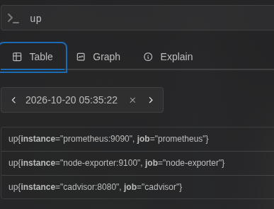
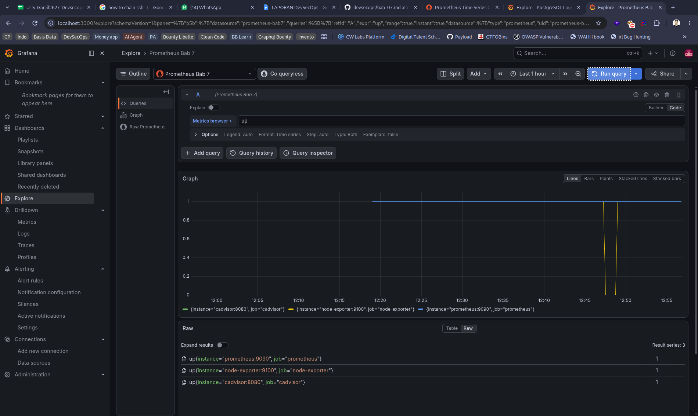
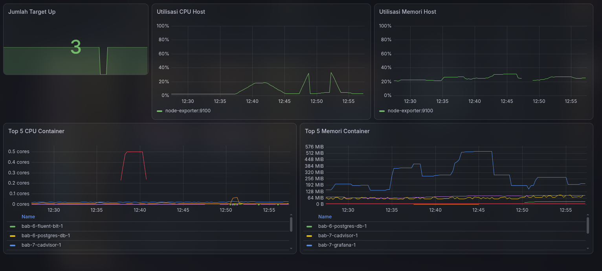
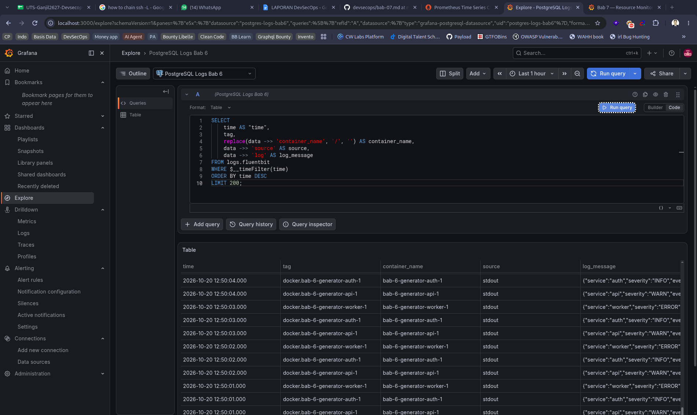
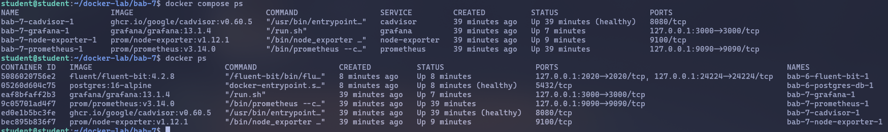
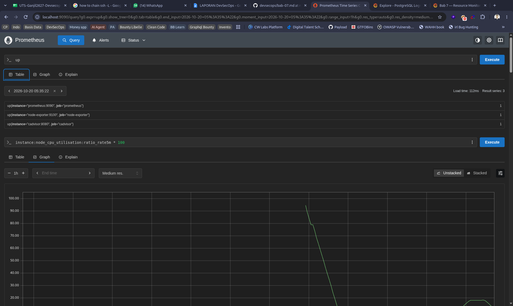
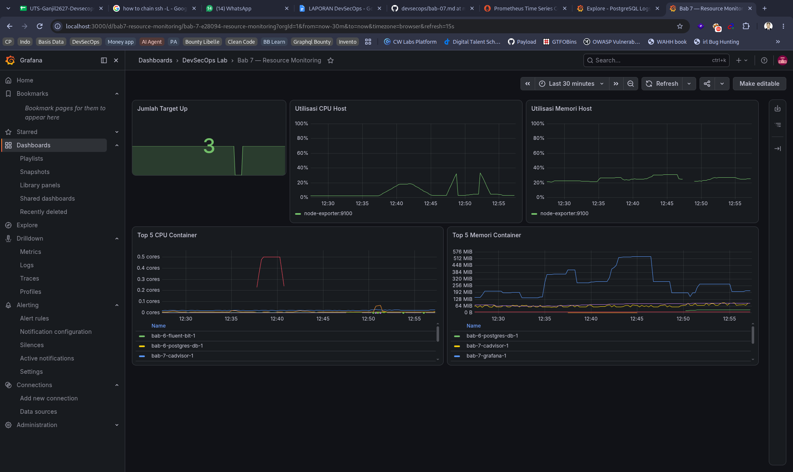
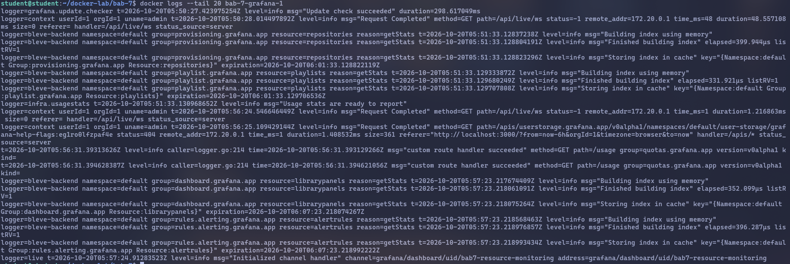

> **Lampiran Dokumen PDF:** [LAPORAN DevSecOps BAB-7.pdf](./docker-lab/bab-7/LAPORAN%20DevSecOps%20BAB-7.pdf)

<object data="./docker-lab/bab-7/LAPORAN%20DevSecOps%20BAB-7.pdf" type="application/pdf" width="100%" height="600px">
  
Pratinjau PDF tidak didukung oleh viewer. Buka tautan file: <a href="./docker-lab/bab-7/LAPORAN%20DevSecOps%20BAB-7.pdf">LAPORAN DevSecOps BAB-7.pdf</a>.

</object>

# **Verifikasi dan Skenario Pengujian**

\[ \] Semua target Prometheus berstatus up.

Buka Prometheus dan ketik query “up”.

\[ \] Grafana berhasil menambahkan Prometheus sebagai data source.

Langsung buka grafana dan cari di explorer.

\[ \] Dashboard menampilkan CPU, memory, dan container metrics.

CPU, Memory, dan Container metrics nyala semua untuk semua container yang berjalan (yang memberikan log).

\[ \] Grafana dapat membaca data source PostgreSQL untuk log lab.

Jalankan bab 6, lalu jalankan script [connect-bab6.sh](http://connect-bab6.sh). Lalu liat di grafana dan ubah datasource yang dropdown ke logs bab 6\.

\[ \] Mahasiswa mampu menjelaskan perbedaan rate dan counter mentah.

* Counter Mentah: Metrik yang nilainya selalu bertambah secara kumulatif dan menunjukkan nilai absolut dari suatu aktivitas, seperti total request, error, atau byte. Membaca counter mentah secara langsung merupakan kesalahan umum karena grafiknya hanya akan terlihat terus menanjak sehingga tidak merepresentasikan throughput aktual sistem, dan nilainya dapat kembali ke nol jika proses mengalami restart.  
* Rate: Fungsi agregasi temporal yang menghitung laju perubahan dari nilai counter dalam rentang waktu tertentu. Counter harus dianalisis menggunakan rate untuk menunjukkan kecepatan atau beban aktual sistem (misalnya perubahan pemakaian CPU per 5 menit), karena fungsi ini secara otomatis menyesuaikan perhitungan meskipun terjadi restart pada proses.

# **Evaluasi dan Latihan Mandiri**

1. Mengapa Prometheus menggunakan scrape model dan bukan hanya push model?

Prometheus menggunakan model pull (atau scrape) di mana server melakukan scrape pada endpoint /metrics dari target secara berkala. Pendekatan ini secara efisien mengumpulkan time series dengan mempertahankan dimensi terbatas yang relevan untuk keputusan operasi.

2. Apa dampak scrape\_interval terlalu kecil terhadap storage dan network?

Interval scrape menentukan resolusi data metrik dan biaya. Jika scrape\_interval diatur terlalu kecil, hal tersebut akan memakan biaya yang lebih besar pada penggunaan memori, storage, dan juga network.

3. Mengapa rate diperlukan untuk counter seperti node\_cpu\_seconds\_total?

Tipe metrik counter hanya bertambah dan harus dianalisis sebagai rate (laju perubahan), bukan nilai absolut, karena proses dapat mengalami restart sewaktu-waktu. Membaca counter mentah tanpa rate adalah kesalahan umum yang membuat grafik terlihat naik terus tanpa merepresentasikan throughput aktual dari sistem.

4. Apa indikator awal container mengalami memory pressure?

Memori working set berbeda dari memori cache, sehingga penggunaan memori yang mendekati limit belum tentu merupakan sebuah error. Namun, indikator awal dan evidence kuat bahwa container benar-benar mengalami memory pressure adalah terjadinya OOM event (Out of Memory) dan proses restart.

5. Bagaimana menghubungkan alert metrics dengan pencarian log?

Metric dan log digunakan secara bersama untuk merespons insiden, metric efisien untuk mendeteksi tren serta alert ("apa yang sedang terjadi"), sedangkan log menyimpan detail event ("mengapa hal itu terjadi"). Keduanya dihubungkan dengan menyertakan evidence yang mencatat waktu observasi, ekspresi PromQL, label target, versi konfigurasi, serta event pemicunya.

# **Bukti minimum:**

Screenshot docker compose ps atau docker ps yang menunjukkan service berjalan.

Screenshot hasil curl/browser/API/dashboard sesuai target bab.

Forwarding pakai : ssh \-J root@100.115.38.31 \-L 9090:localhost:9090 \-L 3000:localhost:3000 student@10.252.108.105

Cuplikan log atau query yang membuktikan sistem bekerja.

# **Analisis wajib:**

1. Jelaskan satu masalah yang muncul dan cara Anda mendiagnosisnya.

Masalah: Sebuah service terlihat sehat dan berjalan normal, tetapi pada saat pengujian, security gate gagal.

Diagnosis: Hal ini terjadi karena healthcheck standar hanya memeriksa availability (ketersediaan) dari service. Masalah ini dapat didiagnosis dan diselesaikan dengan cara meninjau kembali konfigurasi policy, hasil scan, identity, signature, dan evidence secara terpisah dari healthcheck utama.

2. Jelaskan risiko keamanan atau operasional yang relevan pada bab ini.

Mengekspos endpoint metric memiliki risiko keamanan karena dapat membocorkan versi aplikasi, nama host, route, pola beban sistem, hingga identifier. Selain itu, secara operasional pada Grafana, penggunaan akun anonim dan credential default sangat tidak dianjurkan karena tidak sesuai untuk standar produksi.

3. Berikan rekomendasi perbaikan bila lab ini akan dibawa ke production-like environment.

Akses menuju endpoint metric harus dibatasi melalui network, autentikasi, TLS, atau proxy sesuai dengan tingkat risiko keamanan.

Credential untuk setiap data source harus dikelola dengan aman sebagai secret.

Dashboard visualisasi serta alert rule perlu dikelola sebagai configuration-as-code yang secara ketat direview, memiliki versi (terversi), dan selalu diuji.
